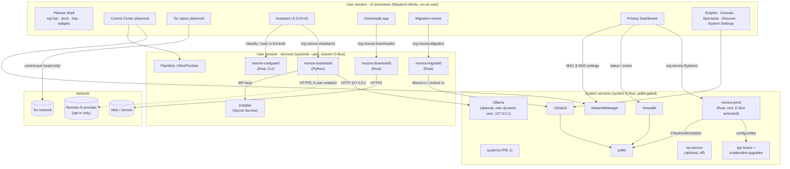
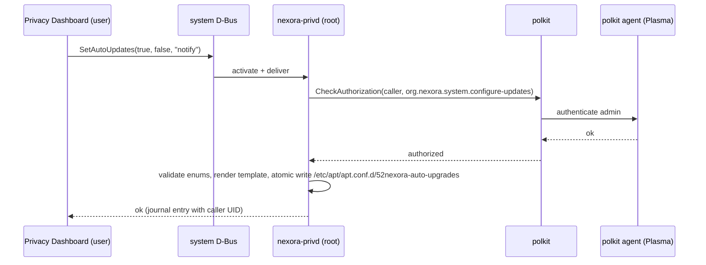

# NEXORA OS — Technical Architecture

Status: Phase 1 deliverable · Target: NEXORA OS 1.0 on Debian 13 "trixie" (amd64)

This document describes what NEXORA OS is made of, which parts are reused from
Debian/KDE and which are written for NEXORA, how processes are separated by
privilege, and how the pieces talk to each other. Companion documents:

- [threat-model.md](threat-model.md) — assets, attackers, mitigations, privacy claims
- [technology-choices.md](technology-choices.md) — decisions, alternatives, versions, licensing
- [design-system.md](design-system.md) — visual language and desktop layout
- [roadmap.md](roadmap.md) — phases 2–8 with acceptance criteria

---

## 1. Goals and non-goals

**Goals**

1. An installable desktop OS built on Debian Stable that a non-expert can use
   every day, with privacy-preserving defaults that do not break normal use.
2. A small number of NEXORA-specific components where Debian/KDE has no good
   answer (AI assistant, Windows migration, download manager, privacy dashboard,
   Tor status), held to a high engineering bar.
3. Honest security: every privacy claim in the UI and docs is technically
   accurate and has a documented limit.
4. Maintainability by a small team: reuse upstream packages, keep custom code
   small, keep every NEXORA change in one monorepo, build reproducibly.

**Non-goals for 1.0**

- Not an anonymity OS. NEXORA does not route system traffic through Tor. Users
  who need whole-system anonymity should use Tails or Whonix (see threat model).
- No custom kernel, no custom display server, no replacement for Plasma Shell,
  KWin, Dolphin or NetworkManager.
- No telemetry of any kind, including opt-out telemetry.
- amd64 only. arm64 is a post-1.0 roadmap item.
- No "secure delete"/wipe tools, no monitoring of other users.

## 2. Architectural principles

| # | Principle | Consequence |
|---|---|---|
| P1 | **Reuse before build.** | File manager = Dolphin, Wi-Fi = NetworkManager + plasma-nm, audio = PipeWire + plasma-pa. NEXORA ships configuration, theming and integration for them, not replacements. |
| P2 | **Build only what differentiates.** | NEXORA-built: assistant, command guard, download manager, Windows migration, privileged helper, privacy dashboard, Tor status, control center widget, artwork, installer settings. |
| P3 | **Least privilege.** | Every UI runs as the logged-in user. Only `nexora-privd` runs as root, is D-Bus activated, systemd-sandboxed, and exposes a closed set of typed methods gated by polkit. |
| P4 | **Use upstream privileged APIs where they exist.** | Mounting = UDisks2, firewall = firewalld D-Bus, units = systemd D-Bus, Wi-Fi = NetworkManager D-Bus. Each already has polkit policies. `nexora-privd` covers only gaps. |
| P5 | **D-Bus interfaces are contracts.** | Each NEXORA service publishes introspection XML in `interfaces/`; Rust, Python, QML and tests are built against it. |
| P6 | **The model proposes, the human decides.** | The AI assistant has no tool that executes anything. Execution is a separate, user-initiated action in a visible terminal. |
| P7 | **Honest status.** | A feature is listed as available only when it works end-to-end on the reference VM. Partial work is labelled in `PROGRESS.md`. |

## 3. Layered view

```
┌──────────────────────────────────────────────────────────────────────────┐
│ L6  Applications (user)    Dolphin · Konsole · Firefox ESR · Tor Browser  │
│                            VS Code · KeePassXC · Vorta · Discover · Ark   │
│                            NEXORA: Assistant · Downloads · Migrate ·      │
│                                    Privacy Dashboard                      │
├──────────────────────────────────────────────────────────────────────────┤
│ L5  Desktop shell (user)   Plasma Shell (top bar, dock, tray, widgets)    │
│                            KWin (Wayland compositor) · kglobalaccel       │
│                            NEXORA plasmoids: Control Center, Tor status   │
├──────────────────────────────────────────────────────────────────────────┤
│ L4  Session services       PipeWire/WirePlumber · KWallet (Secret Svc.)   │
│     (systemd --user)       xdg-desktop-portal-kde · Klipper               │
│                            NEXORA: assistantd · downloadd · migrated      │
├──────────────────────────────────────────────────────────────────────────┤
│ L3  System services        NetworkManager · BlueZ · CUPS · UDisks2        │
│     (root / own users)     firewalld (nftables) · systemd-resolved        │
│                            polkit · apt timers + unattended-upgrades      │
│                            optional tor.service · NEXORA: privd           │
│                            optional Ollama (own user, 127.0.0.1)          │
├──────────────────────────────────────────────────────────────────────────┤
│ L2  Base OS                Debian 13 userland · systemd · AppArmor        │
│                            Linux 6.12 LTS (Debian-signed) · zram swap     │
├──────────────────────────────────────────────────────────────────────────┤
│ L1  Boot & storage         UEFI → shim (MS-signed) → GRUB (Debian-signed) │
│                            → kernel → initramfs (cryptsetup) → LUKS2 root │
└──────────────────────────────────────────────────────────────────────────┘
```

## 4. Requirement → component map

Legend: **U** = upstream package used as-is with NEXORA configuration;
**N** = NEXORA-built; **U+N** = upstream with a NEXORA add-on.

| Req | Capability | Component | Kind | Lang | Runs as |
|---|---|---|---|---|---|
| 1 | Branding, boot, login, themes, icons | `nexora-artwork`, `nexora-plasma-defaults` (GRUB theme, Plymouth, SDDM theme, Plasma look-and-feel, color scheme, wallpapers, icon overrides on Papirus-Dark) | N | QML, SVG, shell | n/a |
| 2 | File manager | Dolphin + KIO + Ark + kio-extras (thumbnails) + UDisks2/Solid; NEXORA service menus and defaults | U+N | config, .desktop | user |
| 3 | Download manager | `nexora-downloadd` (Rust) + Downloads app (QML) | N | Rust, QML | user |
| 4 | Audio | PipeWire + WirePlumber + plasma-pa; NEXORA defaults (mic muted at login option, per-app volume) | U | config | user |
| 5 | AI assistant (Ctrl+E) | `nexora-assistantd` (Python), Assistant UI (QML), `nexora-cmdguard` (Rust); local models through optional Ollama (`nexora-ollama`, see local-ai-ollama.md) | N | Python, QML, Rust | user (Ollama: own dynamic user) |
| 6 | VS Code | `code` from Microsoft's apt repo (see licensing decision), launcher + Dolphin "Open in VS Code" | U | — | user |
| 7 | Windows migration | `nexora-migrated` (Rust) + Migration wizard (QML); mounts via UDisks2 read-only | N | Rust, QML | user |
| 8 | Tor Browser | `torbrowser-launcher` (Debian contrib) + NEXORA Tor status plasmoid + explainer page | U+N | QML | user |
| 9 | Wi-Fi | NetworkManager + plasma-nm; NEXORA privacy defaults (MAC randomisation, no DHCP hostname) | U | config | root/user |
| 10 | Bluetooth, USB, printing, screenshots, notifications, clipboard, task manager, settings, terminal, updates | BlueZ + bluedevil, UDisks2/Solid, CUPS + print-manager, Spectacle, Plasma notifications, Klipper, plasma-systemmonitor, System Settings, Konsole, Discover (PackageKit) | U | config | mixed |
| 11 | Privacy dashboard | Privacy Dashboard app (QML) + `nexora-privd` (Rust) + upstream D-Bus APIs | N | QML, Rust | user + root helper |
| 12 | Secure Boot, LUKS2 | Debian signed shim/GRUB/kernel; Calamares LUKS2; NEXORA status in dashboard | U+N | config | — |
| 13 | Automatic security updates | `unattended-upgrades` + apt timers; settings via `nexora-privd` | U+N | Rust | root |
| 14 | Installer | Calamares + `nexora-calamares-settings` (modules config, branding, slideshow) | U+N | YAML, QML | root (live) |
| 15 | Recovery, backup, logs | Live ISO as rescue system, GRUB recovery mode, Timeshift (btrfs snapshots), Vorta/Borg (encrypted backups), `nexora-collect-logs` | U+N | shell, Rust | mixed |
| + | Password manager / secure notes | KeePassXC (KDBX4, notes entries); KWallet as Secret Service | U | — | user |
| + | VPN | NetworkManager WireGuard (built-in) + OpenVPN plugin, via plasma-nm | U | — | root/user |
| + | Disk health | smartmontools + plasma-disks | U | — | root/user |
| + | Power | PowerDevil + power-profiles-daemon | U | — | user/root |
| + | Accessibility | Orca, KWin zoom, sticky/slow keys, high-contrast NEXORA scheme, reduced motion | U+N | — | user |
| + | Developer tools | git, build-essential, podman (rootless), distrobox, python3-venv, rustup, Kate | U | — | user |

## 5. Component diagram



## 6. Process and privilege model

| Process | User | Bus | Activation | Confinement | Can do | Cannot do |
|---|---|---|---|---|---|---|
| Plasma Shell, KWin, apps | user | session | login | Wayland client isolation | Normal desktop use | Read other clients' input/pixels (Wayland) |
| `nexora-assistantd` | user | session `org.nexora.Assistant1` | D-Bus activation, idles out after 10 min | AppArmor profile; systemd user-unit sandboxing where unprivileged | Call model provider, run *read-only* built-in tools gated by user grants | Execute commands; write its own permission file; read `~/.ssh`, `~/.gnupg`, keyrings, browser profiles, KeePassXC databases |
| Assistant UI | user | session | Ctrl+E via kglobalaccel | AppArmor profile | Render chat, show proposals, write permission grants, launch Konsole | Talk to providers directly |
| `nexora-cmdguard` | user | — (CLI) | spawned by UI | AppArmor profile (exec into Konsole only) | Classify a command string; run an approved string inside a visible terminal | Run without a terminal; elevate privileges itself |
| `nexora-downloadd` | user | session `org.nexora.Downloads1` | D-Bus activation | AppArmor: write only under `$HOME` minus deny-list (see §9) | HTTP(S) downloads, resume, history | Write `~/.bashrc`, `~/.profile`, `~/.config/autostart/**`, `~/.config/systemd/**`, `~/.local/bin/**`, `~/.ssh/**` |
| `nexora-migrated` | user | session `org.nexora.Migrate1` | D-Bus activation | AppArmor: read `/media/$USER/**`, write only `$HOME` minus deny-list | Ask UDisks2 to unlock/mount **read-only**, copy and verify files | Write to any source volume; mount read-write; touch Windows boot files |
| `nexora-privd` | root | system `org.nexora.System1` | D-Bus activation, exits when idle | systemd: `ProtectSystem=strict`, `ReadWritePaths=/etc/apt/apt.conf.d`, `NoNewPrivileges`, `CapabilityBoundingSet=` minimal, `SystemCallFilter=@system-service`, `PrivateNetwork=yes`; AppArmor profile | Fixed typed methods (see §7) after polkit check | Run arbitrary commands, accept file paths or shell strings from callers, open network sockets |
| Ollama (`nexora-ollama`, optional) | own dynamic user | — | system unit `nexora-ollama.service`, started on demand by the assistant (polkit rule for the active session) | `DynamicUser`, `ProtectHome=yes`, `ProtectSystem=strict`, AppArmor; binds `127.0.0.1` only; `OLLAMA_NO_CLOUD=1` | Local inference, model downloads | Network egress (needed only for model downloads); unauthenticated local API (T-AI-10) |
| `tor.service` (optional) | `debian-tor` | — | disabled by default | Debian's AppArmor profile + systemd sandbox | SOCKS on 127.0.0.1:9050 for apps the user configures | Anything system-wide by itself |

**Same-user boundary note.** On desktop Linux, processes of the same user are
not isolated from each other by default. NEXORA uses AppArmor profiles to make
the important same-user boundaries real: `nexora-assistantd` cannot write the
permission store, and the download/migration daemons cannot write files that
grant persistence or code execution at login. This is defence in depth, not a
sandbox for hostile code. Untrusted applications should be installed as Flatpaks.

## 7. IPC contracts (D-Bus)

Interface XML lives in `interfaces/` (created in Phase 2). Summary:

### `org.nexora.Assistant1` (session bus)

| Member | Signature | Notes |
|---|---|---|
| `Ask(conversation_id s, text s) → (request_id s)` | method | Streams results via signals |
| `Cancel(request_id s)` | method | |
| `Token(request_id s, text s)` | signal | Streaming text |
| `ToolActivity(request_id s, tool s, status s)` | signal | Shown in UI ("Searching ~/Documents…") |
| `CommandProposed(request_id s, proposal_id s, command s, explanation s)` | signal | Never executed by the service |
| `PermissionNeeded(request_id s, capability s, detail s)` | signal | UI asks user, writes grant, calls `Resume` |
| `Resume(request_id s)` | method | |
| `ListConversations() → a(sst)`, `DeleteConversation(s)`, `ClearHistory()` | methods | History management |
| `GetProviderStatus() → a{sv}` | method | Provider, model, local/remote, reachable |

### `org.nexora.Downloads1` (session bus)

`Add(url s, destination s, options a{sv}) → (id s)`, `Pause(id)`, `Resume(id)`,
`Cancel(id)`, `Remove(id, delete_file b)`, `List() → a(a{sv})`,
`ClearHistory()`, signals `Progress(id s, received t, total t, rate t)`,
`StateChanged(id s, state s, error s)`.

### `org.nexora.Migrate1` (session bus)

`ScanSources() → a(a{sv})`, `Unlock(source s, recovery_key s)`,
`ListProfiles(source s) → as`, `Plan(source s, profile s, categories as, options a{sv}) → (plan a{sv})`,
`Start(plan_id s)`, `Cancel(plan_id s)`, signals `Progress`, `Finished(plan_id s, report_path s)`.

### `org.nexora.System1` (system bus, `nexora-privd`)

| Method | polkit action | Default auth |
|---|---|---|
| `GetSecurityStatus() → a{sv}` (AppArmor mode & profile counts, LUKS version per mapped device, Secure Boot state, auto-update config) | `org.nexora.system.read-status` | `yes` for active local session |
| `SetAutoUpdates(enabled b, include_updates b, reboot_policy s)` | `org.nexora.system.configure-updates` | `auth_admin_keep` |
| `SetAvahi(enabled b)` | `org.nexora.system.configure-network-discovery` | `auth_admin_keep` |

Everything else (firewall zones, unit enable/disable, Wi-Fi, mounts) goes to
the upstream service's own polkit-protected D-Bus API.

## 8. Key flows

### 8.1 Ctrl+E assistant with a command proposal

```mermaid
sequenceDiagram
  actor U as User
  participant K as KWin / kglobalaccel
  participant UI as Assistant UI
  participant S as nexora-assistantd
  participant P as Model provider
  participant G as nexora-cmdguard
  participant T as Konsole
  U->>K: Ctrl+E
  K->>UI: launch or toggle (single instance)
  U->>UI: "Why is my disk full?"
  UI->>S: Ask(conv, text)
  S->>P: messages + tool schemas (only granted tools)
  P-->>S: tool call get_disk_usage()
  S->>S: grant "system.info.basic"? (else PermissionNeeded → UI → user)
  S-->>P: tool result (summary only)
  P-->>S: tool call propose_command("du -sh ~/.cache/* | sort -h")
  S-->>UI: CommandProposed(...)
  UI->>G: classify(command)
  G-->>UI: tier=read-only, reasons=[]
  UI->>U: Proposal card: command · explanation · risk badge · [Copy] [Run in terminal]
  U->>UI: Run in terminal
  UI->>T: konsole --hold -e nexora-cmdguard exec -- "<exact text shown>"
  Note over G,T: cmdguard re-classifies; tier ≥ admin needs typed confirmation;<br/>sudo prompts for the user's password inside Konsole
```

Rules enforced in code (Phase 5):

- The provider never receives a tool that executes, writes, deletes or sends.
- The UI passes the exact string it displayed to the executor; the string
  is never re-fetched from the model after approval.
- Risk tiers: **read-only** (one click) · **modifies your files** (confirm) ·
  **administrator** (typed confirmation; password asked by `sudo` in Konsole) ·
  **destructive/irreversible** (typed confirmation + 5 s delay) ·
  **blocked** (e.g. `rm -rf /`, `rm -rf ~`, `mkfs` on mounted disks; may be
  copied, never run from the assistant). Unparseable or obfuscated commands
  (`base64 -d | sh`, `eval`, `curl … | sh`) are treated as destructive.
- The classifier is advisory and adds friction; the security boundary is the
  human decision plus the fact that nothing runs with more privilege than the
  user already has.

### 8.2 Privileged setting change (automatic updates)



### 8.3 Windows migration

1. `ScanSources` lists UDisks2 block devices with NTFS/exFAT/FAT or BitLocker.
   A Windows install is recognised by `Windows/System32` and `Users/`.
2. BitLocker volumes: user enters the recovery key; unlock is requested
   **read-only** through UDisks2 (verify the read-only unlock option on
   trixie's UDisks2 in Phase 4; if unavailable, unlocking is not offered and the
   UI says why).
3. Mount via UDisks2 with option `ro`. If Windows was hibernated or Fast Startup
   is on, the volume still mounts read-only; the UI explains that recent changes
   may be missing and how to do a full Windows shutdown. NEXORA never removes the
   hibernation file and never mounts read-write.
4. User picks a Windows profile and categories (Documents, Desktop, Pictures,
   Videos, Music, Downloads, optional browser bookmarks).
5. Dry run: sizes, free space, name conflicts, OneDrive cloud-only placeholders
   (reported as skipped — they contain no local data).
6. Copy with streaming SHA-256, re-read destination to verify, preserve mtimes,
   resumable via a manifest in `~/.local/state/nexora/migrate/`.
7. Bookmarks: Chromium-family `Bookmarks` JSON and Firefox `places.sqlite`
   (copied to a temp file, opened read-only) are exported to a standard
   Netscape bookmarks HTML file. Passwords, cookies and history are **not**
   imported.
8. Unmount; write a human-readable report.

### 8.4 Download with resume

`Add` → HEAD/GET with `Range` → write `<name>.part` → on pause, keep `.part`
and validators (`ETag`/`Last-Modified`) → resume with `Range` + `If-Range` →
if validator changed, restart from zero and tell the user → on completion,
optional SHA-256 check against a user-supplied hash → atomic rename. Filenames
from `Content-Disposition` are sanitised (no path separators, no leading dots,
no control characters).

## 9. Data, configuration and secrets

| Data | Location | Sensitivity | Protection |
|---|---|---|---|
| Assistant history | `~/.local/share/nexora/assistant/history.sqlite` | High | User-only perms; retention setting (default 30 days); "Clear history"; at rest protected by LUKS |
| Assistant grants | `~/.config/nexora/assistant/permissions.toml` | High | Written only by the UI; `nexora-assistantd` AppArmor profile denies writes |
| AI API keys | KWallet via Secret Service | High | Never in files, env vars or logs |
| Local models | `~/.local/share/nexora/models/` | Low | SHA-256 verified on download |
| Download history | `~/.local/share/nexora/downloads/history.sqlite` | Medium | Clearable; private-mode downloads not recorded |
| Migration manifests/reports | `~/.local/state/nexora/migrate/` | Medium | User-only perms |
| System policy | `/etc/nexora/`, `/etc/apt/apt.conf.d/52nexora-*` | Integrity | Root-owned; written only by `nexora-privd` or packages |
| Logs | systemd journal | Medium | Local only; `nexora-collect-logs` redacts usernames, hostnames, SSIDs, MACs, IPs before export |

Persistence deny-list used in AppArmor profiles of daemons that write user files:
`~/.bashrc ~/.profile ~/.bash_profile ~/.zshrc ~/.config/autostart/** ~/.config/systemd/** ~/.config/plasma-workspace/env/** ~/.local/bin/** ~/.local/share/applications/** ~/.ssh/** ~/.gnupg/**`.

## 10. Boot, install and live system

```
UEFI (Secure Boot on) → shimx64.efi (Microsoft UEFI CA signed, from shim-signed)
  → grubx64.efi (Debian-signed, NEXORA theme) → vmlinuz (Debian-signed)
  → initramfs (initramfs-tools: cryptsetup, plymouth) → LUKS2 passphrase prompt
  → systemd → SDDM (NEXORA theme) → Plasma Wayland session
```

- **Live ISO** (live-build, `iso-hybrid`): boots UEFI and legacy BIOS; desktop
  icon "Install NEXORA OS" launches Calamares. The live system doubles as the
  recovery medium (GParted, TestDisk/PhotoRec, cryptsetup, smartctl, Timeshift).
- **Default disk layout** (Calamares "Erase disk"): ESP 512 MiB (FAT32) ·
  `/boot` 1 GiB (ext4, unencrypted) · LUKS2 (argon2id) containing btrfs with
  subvolumes `@` and `@home` · swap = zram (no disk swap).
  Rationale and trade-offs (GRUB's LUKS2 limits, evil-maid exposure of `/boot`)
  are in the threat model and technology choices.
- **No custom kernel or bootloader build.** Using Debian's signed binaries is
  what lets NEXORA boot with Secure Boot enabled without its own Microsoft
  signing. Third-party DKMS modules (e.g. NVIDIA proprietary) require MOK
  enrollment by the user.

## 11. Updates

| Channel | Mechanism | Default |
|---|---|---|
| Debian security | `unattended-upgrades` (origin `Debian-Security`) via apt timers | **On**, daily, no automatic reboot; Plasma notification when a reboot is needed |
| Debian stable point updates | Discover (PackageKit) offline updates, applied on reboot | Notify weekly |
| NEXORA packages | Signed NEXORA apt repository | **Open decision:** hosting + key custody (see roadmap). Until it exists, NEXORA packages update only via new ISO/manual `.deb`. |
| VS Code | Microsoft apt repo (signed-by key pinned) | via apt |
| Tor Browser | `torbrowser-launcher` downloads and verifies signatures from torproject.org; Tor Browser self-updates | on |
| Flatpak apps | Flathub (user opt-in in Discover) | off until enabled |

## 12. Logging and diagnostics

- Rust: `tracing` → `tracing-journald`; Python: `logging` → `systemd.journal`
  handler (fallback stderr, captured by journald). Structured fields
  (`NEXORA_COMPONENT`, `REQUEST_ID`), never message contents, prompts, file
  contents, URLs with query strings, or secrets.
- `nexora-collect-logs`: user-initiated, writes a redacted archive to
  `~/Documents/nexora-logs-<date>.tar.zst`, never uploads.

## 13. Monorepo layout

```
nexora-os/
├── README.md · PROGRESS.md · REUSE.toml · LICENSES/ · Makefile
├── debian/                     # one native source package → many binary packages
├── build/                      # Containerfile.trixie (pinned), build-debs.sh, build-iso.sh, snapshot pin
├── distro/
│   ├── live-build/             # auto/, config/{package-lists,archives,hooks,includes.chroot,bootloaders}
│   └── calamares/              # settings.conf, modules/*.conf, branding/nexora/
├── interfaces/                 # D-Bus introspection XML (API contracts)
├── crates/                     # Rust workspace (MSRV = Debian trixie rustc)
│   ├── nexora-common/          # logging, config, errors, D-Bus helpers
│   ├── nexora-downloadd/
│   ├── nexora-migrate/         # library + daemon
│   ├── nexora-cmdguard/
│   └── nexora-privd/
├── python/nexora_assistant/    # assistantd: providers, permissions, tools, history, tests
├── ui/                         # QML apps + thin PySide6 hosts
│   ├── Nexora/                 # shared QML module (controls, tokens)
│   └── assistant/ downloads/ migrate/ privacy/
├── plasma/                     # look-and-feel, color schemes, layout script, plasmoids, kwin rules
├── artwork/                    # SVG sources → wallpapers, logos, icons, plymouth, grub, sddm
├── security/                   # apparmor/, polkit/, sysctl/, firewalld/, networkmanager/, systemd/
├── tests/                      # integration/ (private D-Bus), iso/ (QEMU smoke), design/ (contrast)
└── docs/                       # architecture, threat model, choices, design, roadmap, user/, troubleshooting/
```

### Binary packages produced from `debian/`

| Package | Contents |
|---|---|
| `nexora-base` | os-release diversion (`ID=nexora`, `ID_LIKE=debian`, `VERSION_CODENAME=trixie` kept for third-party repo compatibility), apt sources, `/etc/nexora/` |
| `nexora-security-defaults` | sysctl, NetworkManager privacy conf, firewalld default zone, resolved conf, zram, coredump policy, AppArmor profiles for NEXORA binaries, polkit actions |
| `nexora-artwork` | wallpapers, logos, Plymouth/GRUB/SDDM themes, icon overrides |
| `nexora-plasma-defaults` | `/etc/xdg` defaults, look-and-feel, layout, plasmoids, Konsole profile, `/etc/skel` |
| `nexora-downloads` · `nexora-migrate` · `nexora-assistant` · `nexora-privacy` | apps + daemons + units + D-Bus service files |
| `nexora-calamares-settings` | installer config and branding (live image only) |
| `nexora-desktop` | metapackage: everything above + upstream package set |

## 14. Build pipeline

```
make debs  → container (debian:trixie pinned by digest, apt from snapshot.debian.org at a fixed timestamp)
           → dpkg-buildpackage (cargo --locked --offline with vendored crates; pybuild)
           → ./out/debs/*.deb + lintian report
make iso   → privileged container → live-build (mirror = same snapshot, SOURCE_DATE_EPOCH set)
           → copies ./out/debs into config/packages.chroot/
           → ./out/nexora-<version>-amd64.iso + SHA256SUMS
make test  → cargo test · pytest · qmltestrunner (offscreen) · D-Bus integration on a private bus
make smoke → QEMU (OVMF, serial console) boots the ISO to multi-user/graphical target
```

Host used for this project: Windows 11 with Docker (Linux containers) and
Hyper-V. All builds run in containers; GUI validation runs in a Hyper-V
Generation 2 VM with Secure Boot set to the "Microsoft UEFI Certificate
Authority" template.
